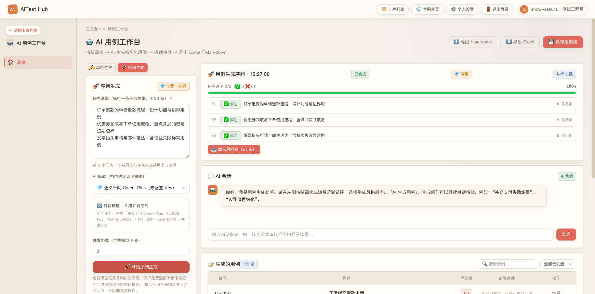
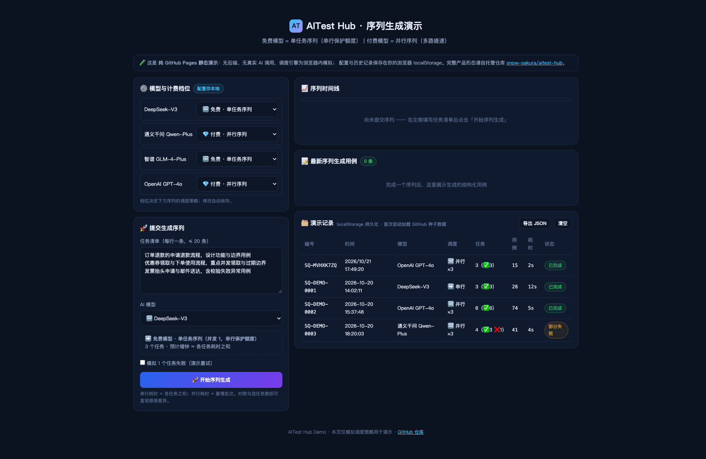

# AITest Hub

> AI 驱动的测试工程师在线工具箱 —— 用例生成 · 接口/场景测试 · UI 自动化 · 性能压测 · 缺陷管理 · 提示词库，浏览器打开即用。


---

## ✨ 这是什么

AITest Hub 把测试工程师日常最常用的能力聚合进一个平台：

| 能力域 | 模块 |
|--------|------|
| AI 用例 | 需求粘贴 → AI 生成结构化用例 → 会话精修 → 导出 Excel/Markdown |
| 接口测试 | 单接口调试、场景编排（步骤链/变量传递）、**生成序列调度** |
| 自动化 | UI 自动化（Playwright）、App 自动化编排 |
| 性能 | 压测场景编排与结果解读 |
| 管理 | 缺陷管理、需求管理（追溯矩阵）、知识库、调度中心、工作流 |
| 资产 | 提示词库（分类/搜索/一键复制）、配置中心（多模型 + 计费档位） |

后台为 FastAPI + SQLite（零外部依赖），前端为 Vue 3 SPA，单条命令即可自托管。

---

## 🔋 本次主打：序列生成 —— 免费模型串行、付费模型并行

多份需求批量丢给 AI 时，**免费模型的额度经不起并发轰击，付费模型又不该排队**。
AITest Hub 按模型「计费档位」自动选择调度策略：

```text
🆓 免费模型（tier=free）→ 单任务序列：并发固定 1，任务按提交顺序串行执行
                            ↳ 保护免费额度，避免限流把整批任务打断
💎 付费模型（tier=paid） → 并行序列：默认同时 3 路（可配 1-8），吞吐随并发数提升
```

### 全流程操作（截图实测）

**① 打开「AI 用例工作台」，每个模型自带计费徽标（🆓/💎）**


**② 切到「序列生成」页签：每行一条任务需求，选定模型后实时预览调度策略**
免费模型立即显示 *➡️ 单任务序列（并发 1，串行保护额度）* 与预计墙钟时间。


**③ 提交后右侧出现实时时间线**：序号任务 chip 按 01→02→03 逐个推进，
免费模型严格串行（本图为真实 AMD 模型实测，每任务 1~3 分钟真实推理）。


**④ 全部完成后一键「载入用例表」**，跨任务用例统一汇入、可编辑可导出。


**⑤ 换成 💎 付费模型：预览切换为 *🔀 3 路并行*，时间线上 3 个任务同时执行中。**


同样的 3 个任务，并行约 3 秒完成 —— 加速肉眼可见：



**⑥ 计费档位可随时改**：配置中心 → AI 模型 → 「计费档位」下拉，保存即对全站调度生效。


> 配套可靠性修复：所有 AI 流式生成内置 **停滞看门狗**（服务端 75s / 前端 120s），
> 慢速模型不再“永远转圈”；截断输出自动修复出结构化用例。

---

## 🚀 快速开始

### 环境要求

- Python ≥ 3.11
- Node.js ≥ 20

### 后端（默认 :8000，本文演示 :8010）

```bash
cd backend
python -m venv .venv && source .venv/bin/activate
pip install -r requirements.txt
uvicorn app.main:app --host 127.0.0.1 --port 8010
```

首次启动自动建库（SQLite `backend/app/aitest_hub.db`）并写入种子数据：
内置 AI 模型（含免费/付费档位）、演示账号、知识库样例。

### 前端

```bash
cd frontend
npm install
# 开发模式（后端不在 8000 时）：
VITE_API_TARGET=http://127.0.0.1:8010 npm run dev
# 生产构建（构建后由 FastAPI 同源托管，直接访问后端端口即可）：
npm run build
```

打开 `http://127.0.0.1:8010/`，演示账号：`13800000000 / Demo@2026`
（由环境变量 `DEMO_ACCOUNT` / `DEMO_PASSWORD` 覆盖，见 `.env.example`；登录页「一键填充」自动读取 `GET /api/config/demo-account`，前端不内置账号）

### 配置你的模型

配置中心 → AI 模型：填 API Key、选提供商、**选计费档位**（🆓 免费=串行保护额度 / 💎 付费=并行提速）。
模型未配置 Key 时优先借道平台其他可用通道真调，无可用通道则回落演示模拟，离线也能完整体验序列调度。

---

## 🧭 核心 API 速览（序列调度）

```text
GET  /api/gen-queue/scheduling-preview?model_id=&task_count=   # 提交前预览：串行/并行N路
POST /api/gen-queue/sequences                                   # 提交序列（≤20 任务）
GET  /api/gen-queue/sequences/{sid}                             # 详情（含每任务状态/用例）
POST /api/gen-queue/sequences/{sid}/cancel                      # 取消
POST /api/gen-queue/sequences/{sid}/retry-failed                # 只重试失败任务
GET/PUT /api/gen-queue/settings                                 # 付费默认并发（1-8）
```

完整接口与设计说明见 [`docs/TECHNICAL.md`](docs/TECHNICAL.md)，
使用教程见 [`docs/USER-GUIDE.md`](docs/USER-GUIDE.md)，需求背景见 [`docs/REQUIREMENTS.md`](docs/REQUIREMENTS.md)。

---

## 📁 项目结构

```text
aitest-hub/
├── backend/app/
│   ├── main.py              # FastAPI 入口：流式看门狗 / SPA 挂载与 history 回退
│   ├── api/gen_queue.py     # 序列调度 REST
│   ├── services/gen_queue.py# 调度器：free=串行 / paid=Semaphore 并行、取消、重试
│   ├── services/ai.py       # 统一 AI 服务（配置中心档位同步）
│   ├── services/ai_parse.py # 用例解析 + 截断自动修复
│   └── core/database.py     # SQLite（启动迁移 ai_configs.tier）
├── frontend/src/views/tools/
│   ├── tool-test-cases.vue      # 序列生成页签 + 时间线 + SSE 看门狗
│   └── tool-config-center.vue   # 计费档位配置
├── demo/                    # 纯 GitHub Pages 静态演示（无需后端）
├── docs/                    # 需求 / 技术 / 操作说明 / 迭代 SPEC / 截图
└── scripts/                 # 端到端校验脚本
```

---

## 🌐 在线演示（纯 GitHub Pages）

[`demo/`](demo/) 是零后端静态演示：模型配置、档位调度模拟、序列时间线、
演示记录数据持久化（localStorage，可导出）。见仓库 Pages 地址：
`https://snow-sakura.github.io/aitest-hub/demo/`



---

## 🔐 安全与隐私

- 仓库不包含任何真实 API Key：Key 仅存于本地 SQLite（已 .gitignore）与浏览器端。
- 序列任务数据存本地库；演示模式不发出任何外部请求。
- 内置种子模型档位仅作展示（通义/GPT-4o=paid、其余=free），请按实际计费修改。

## License

个人学习与日用免费（见仓库说明）。
