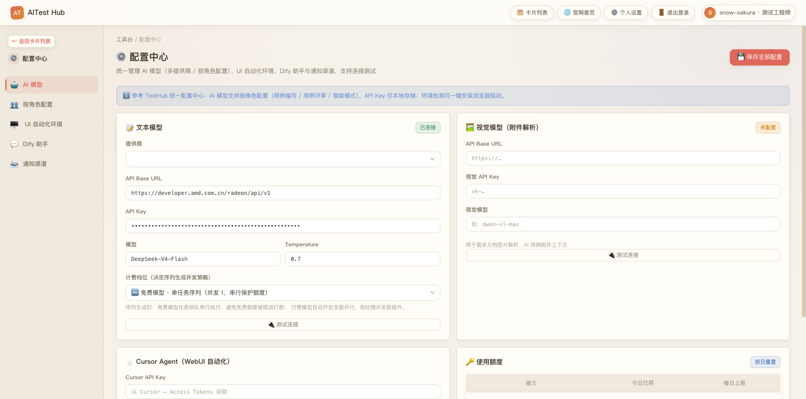
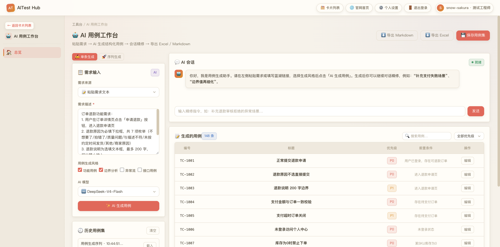
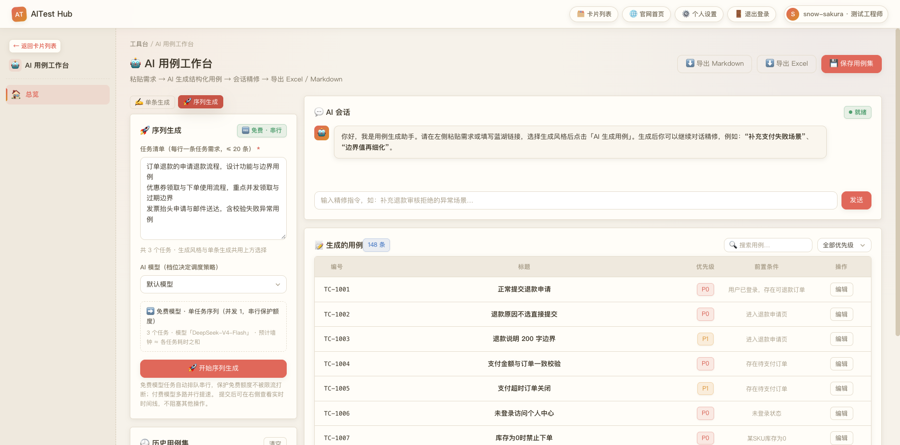
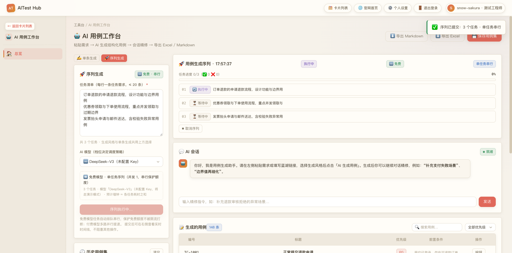
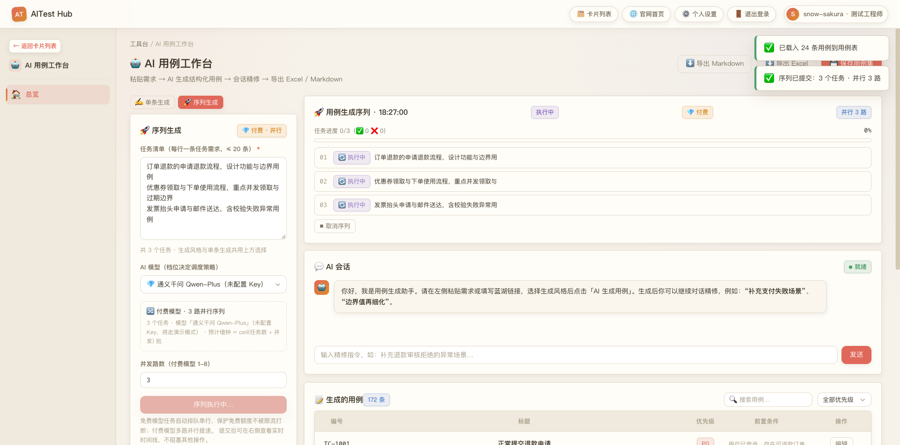
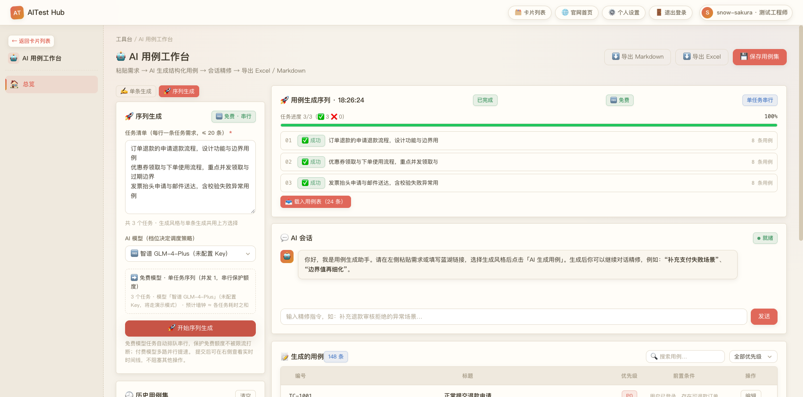
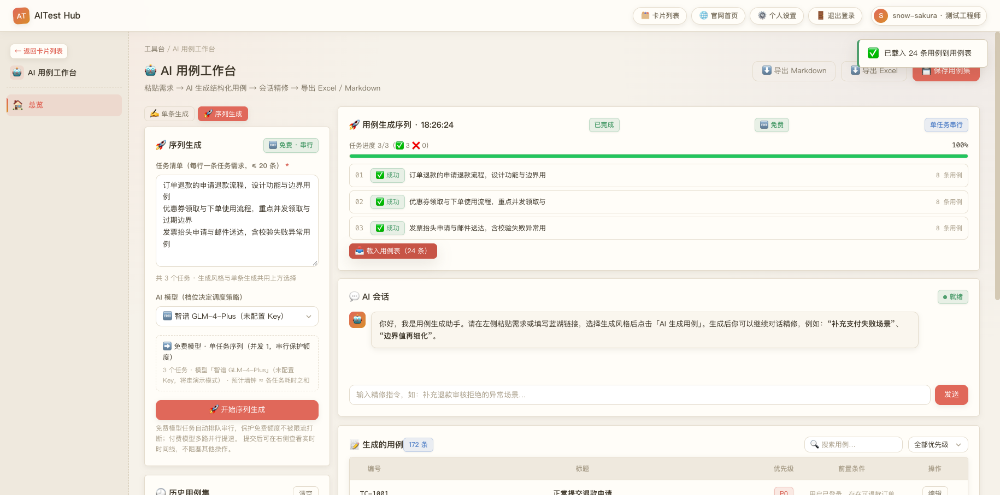

# 操作说明 · AITest Hub 使用指南

> 面向测试工程师的上手手册。全流程截图见 `docs/images/`。

## 0. 登录与入口

1. 启动服务后打开 `http://127.0.0.1:8010/`（或你部署的地址）。
2. 右上角「登录」。当前登录用 **11 位手机号**：
   - 演示账号：`13800000000` / `Demo@2026`（环境变量 `DEMO_ACCOUNT` / `DEMO_PASSWORD` 可覆盖）
   - 管理员（本地开发库种子）：`admin` / `admin123`
3. 未登录也可浏览首页与提示词库；生成类接口支持匿名（记录为游客）。

## 1. 配置你的 AI 模型（配置中心）

路径：工作台 → 配置中心 → 「AI 模型」页签。

1. 填写提供商 / API Base URL / API Key / 模型名 / Temperature。
2. **选择「计费档位」**（决定序列生成的并发策略）：
   - 🆓 免费模型 · 单任务序列（并发 1，串行保护额度）
   - 💎 付费模型 · 并行序列（默认 3 路，可到序列面板临时调 1-8）
3. 「保存全部配置」即时生效；「▷ 测试连接」验证连通性。
4. **没填 Key 的模型**：平台若有其他可用通道（默认模型）会借道真调，否则回落演示模拟输出——离线也能体验完整生成与调度流程。



> 内置模型已预置档位：通义千问 / GPT-4o = 💎 付费，DeepSeek / GLM / Kimi / Ollama = 🆓 免费，
> 请按你的真实计费修改。

## 2. 单条生成用例

路径：工作台 → AI 用例工作台 → 「✍️ 单条生成」。

1. 需求来源三选一：粘贴文本 / 蓝湖链接 / 上传附件（TXT/MD/DOCX/PDF/图片 ≤5MB ×5）。
2. 勾选生成风格：功能用例 / 边界分析 / 异常流 / 接口用例。
3. 选择 AI 模型（下拉带 🆓/💎 徽标），点「✨ AI 生成用例」。
4. AI 会话区实时流式输出 → 自动解析为结构化用例表；
   慢速模型若中断，系统会截断修复并标注「已自动修复」。
5. 右侧会话框输入精修指令（如"补充支付失败场景"），AI 回复中的 JSON 用例会**自动追加入表**。
6. 行内「编辑」可改标题/优先级/前置/步骤/预期；顶部可导出 Markdown/Excel、保存用例集。



## 3. 序列生成（本版本核心）

路径：AI 用例工作台 → 「🚀 序列生成」页签。

### 3.1 提交
1. **任务清单**：每行一条独立需求（≤20 行）。示例：
   ```text
   订单退款的申请退款流程，设计功能与边界用例
   优惠券领取与下单使用流程，重点并发领取与过期边界
   发票抬头申请与邮件送达，含校验失败异常用例
   ```
2. 选择模型：选完立刻显示调度预览徽标——
   - `➡️ 免费模型 · 单任务序列（并发 1，串行保护额度）`
   - `🔀 付费模型 · N 路并行序列`，并可临时调整并发路数（1-8）。
3. 点「🚀 开始序列生成」。风格沿用上方勾选；提交即定档，之后改配置不影响已提交序列。



### 3.2 监控（右侧序列时间线）
- 每任务一行：`01 ⏳ 等待中 → 🔄 执行中 → ✅ 成功 / ❌ 失败`；顶部总进度条。
- 免费模型：严格 01→02→03 串行推进（真实 AMD 模型每任务 1~3 分钟属正常）。
- 付费模型：前 N 个任务同时 🔄（并行加速肉眼可见）。




### 3.3 善后操作
| 按钮 | 时机 | 行为 |
|------|------|------|
| ⏹ 取消序列 | 执行中 | 未完成任务置「已取消」，已完成结果保留 |
| 🔁 重试失败任务 | 结束后有失败 | 只把失败/已取消项重新入队，成功项不动 |
| 📥 载入用例表 | 有成功用例 | 全部任务用例合并编号写入下方用例表，可编辑/导出 |




实测对比：同样 3 个任务，免费（真实模型串行）约 4 分钟完成 45 条；
💎 付费并行约 3 秒完成（演示模型）。

## 4. 常见问题

**Q1 生成一直转圈/失败？**
已全部修复：服务端 75s、前端 120s 停滞自动终止并给出明确原因；
慢模型建议改用「序列生成」（队列稳定、失败可单独重试）。

**Q2 提示"未配置 Key，将走演示模式"？**
正常：该模型没填 API Key。系统会优先回落借用配置中心里其他已配置成功的通道真调；无任何可用通道时回落演示模拟输出。为该模型填入真实 Key 后即走它自己的通道。

**Q3 序列服务重启后显示「已中断」？**
进程重启会丢失内存中的执行任务，属预期；点「🔁 重试失败任务」即可续跑。

**Q4 免费模型能开并行吗？**
策略上固定并发 1（防止免费额度被并发限流整批打断）。确有富余额度时，
在配置中心把该模型档位改成 💎 付费即可放开。

**Q5 数据存在哪？会上传吗？**
全部在你本机 SQLite（`backend/app/aitest_hub.db`）；API Key 不入库文件、不出本机
（除直连你配置的模型 API）。仓库不含任何真实密钥与当地数据库。

## 5. 进阶

- 默认并发调整：`PUT /api/gen-queue/settings {"paid_concurrency": 4}`。
- 演示辅助：启动前 `export GQ_ITEM_DELAY=1.5` 让每个任务固定耗时，时间线动画更直观。
- 接口清单见 `docs/TECHNICAL.md`；迭代背景与验收记录见 `docs/SPEC-iteration-202610.md`。
